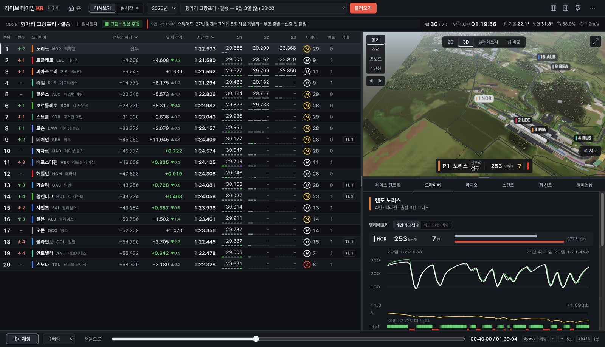
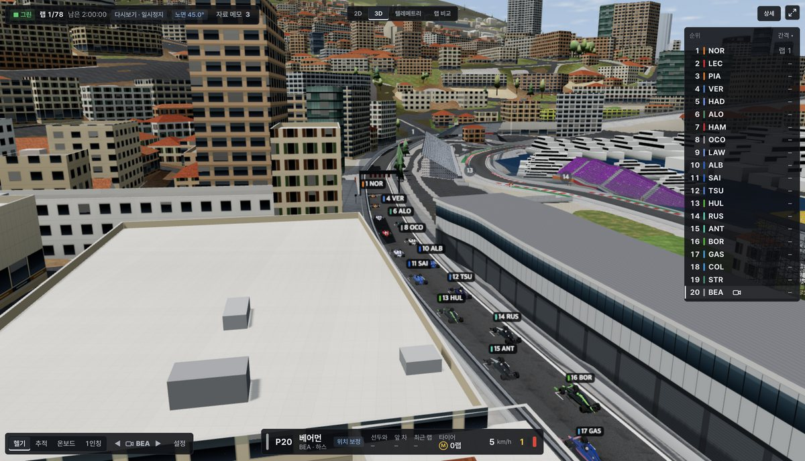
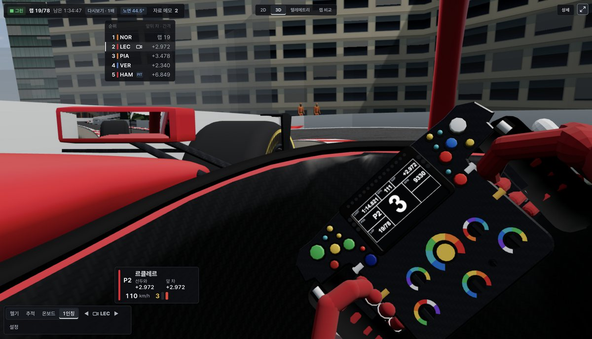
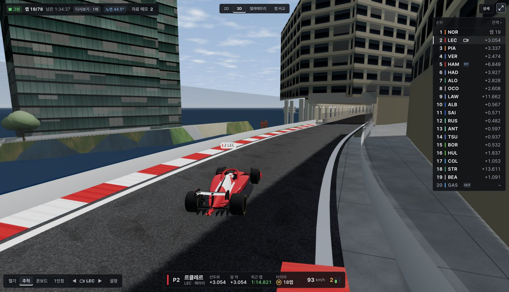
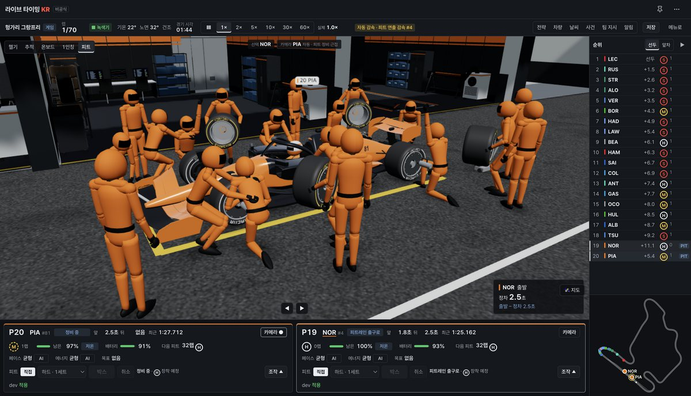
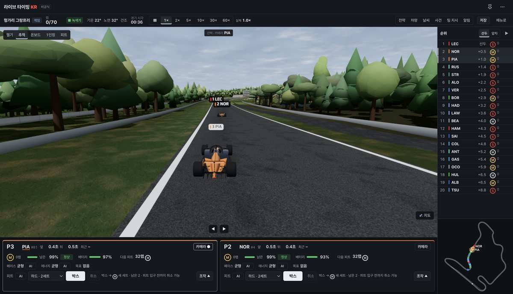

# 라이브 타이밍 KR

F1 세션을 한국어로 보는 비공식·개인용 데스크톱 앱입니다(Formula 1과 무관).

## 목적과 사용자

중계를 보며 경기를 깊이 이해하고 싶은 한국어 F1 팬을 위한 앱입니다. 목표는 **실제 F1 차량의 움직임을 3D로 최대한 비슷하게 재현**하는 것입니다.

| 모나코 출발 그리드 | 1인칭 시점 |
|---|---|
|  |  |
| **추적 시점** | **게임 피트 스톱** |
|  |  |
| **전략 게임 운영** | |
|  | |

## 실행

`npm install && npm start` (테스트 `npm test`). 다시보기 → 세션 → 불러오기, 3D에서 시점을 고릅니다.

## 작업 과정

Claude Code와 회차별로 증상 재현 → 원인 단계 찾기 → 수정 → 같은 경기로 전후 측정 → 실제 앱 확인 → 출시했습니다. 차량은 F1 위치·속도 자료를 보정 경로·피트 경로·그리드로 이어 그립니다.

## 검증 (v0.54)

2026 헝가리 설명 불가 이동 29,835 → 146, 47경기 스캔, 온보드 차체 가라앉음 3–10 m → 3 cm 이하, 게임 미끄러짐 12° → 1.4°, 테스트 986/986.

## 효과적이었던 점

1. 모든 차의 최종 자세를 검사하는 도구를 먼저 만듦
2. 같은 경기·숫자로 전후 비교
3. 헬퍼 에이전트로 영역을 나눠 동시 작업

## 어려웠던 점

1. 위치 자료가 멈추고 되돌아가고 튀어 실제 움직임을 모르는 구간
2. 하나를 고치면 다른 어색함(미끄러짐 ↔ 순간 이동)
3. 숫자가 좋아져도 눈으로는 진짜 F1 같지 않음(방향·기울기·피트 진입)

## 한계

실시간 미검증. 손상 구간은 차를 숨기고, 출발 직후 겹침과 일부 순간 이동이 남음.

## 핵심 파일

`src/renderer/` `replay.js` `smooth.js` `startplan.js` `pitpath.js` `heading.js`

[출처](THIRD_PARTY_NOTICES.md)
