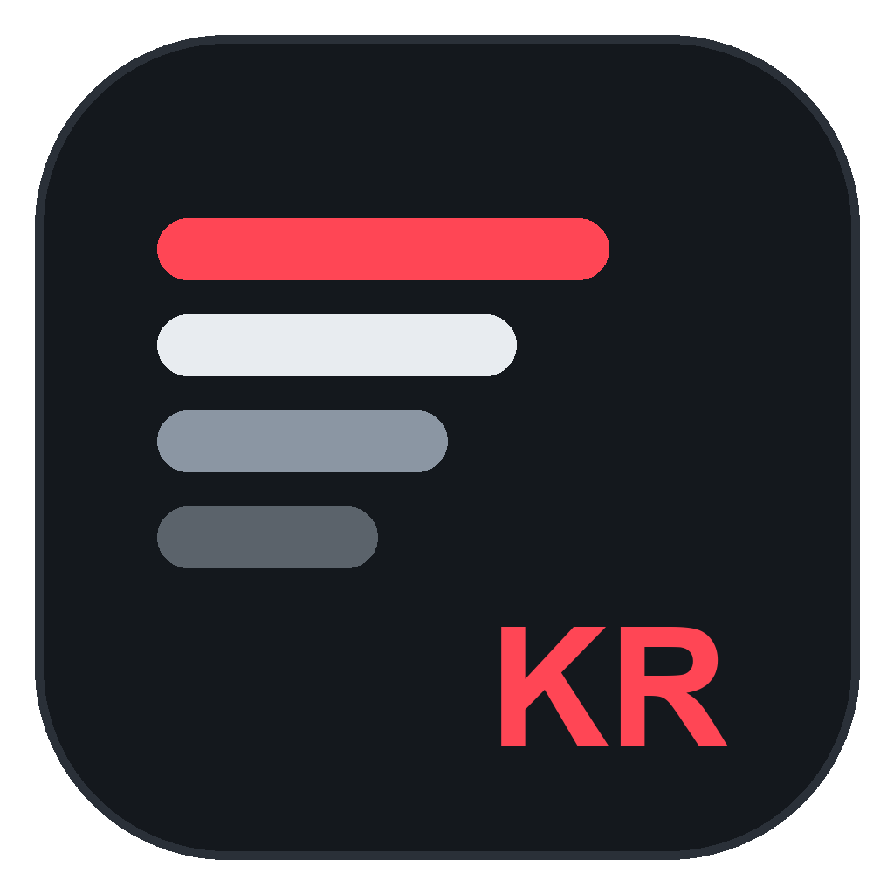
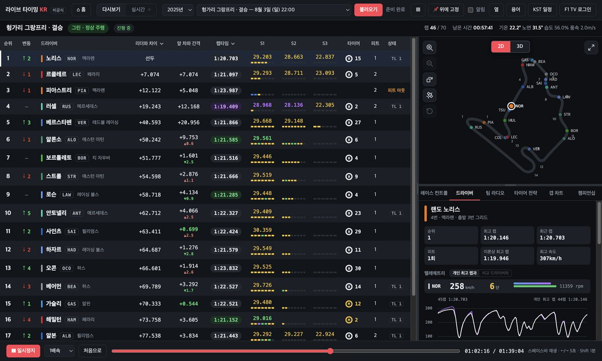
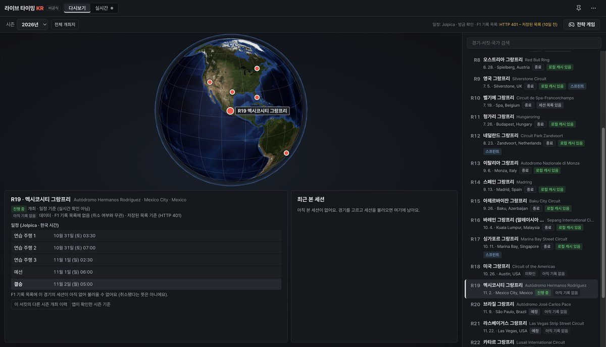
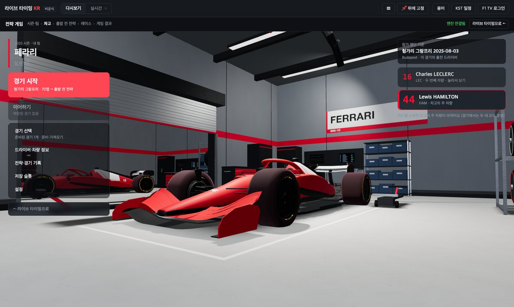
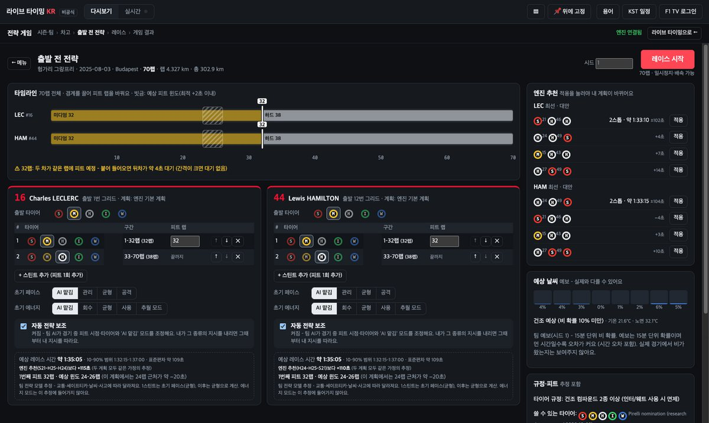
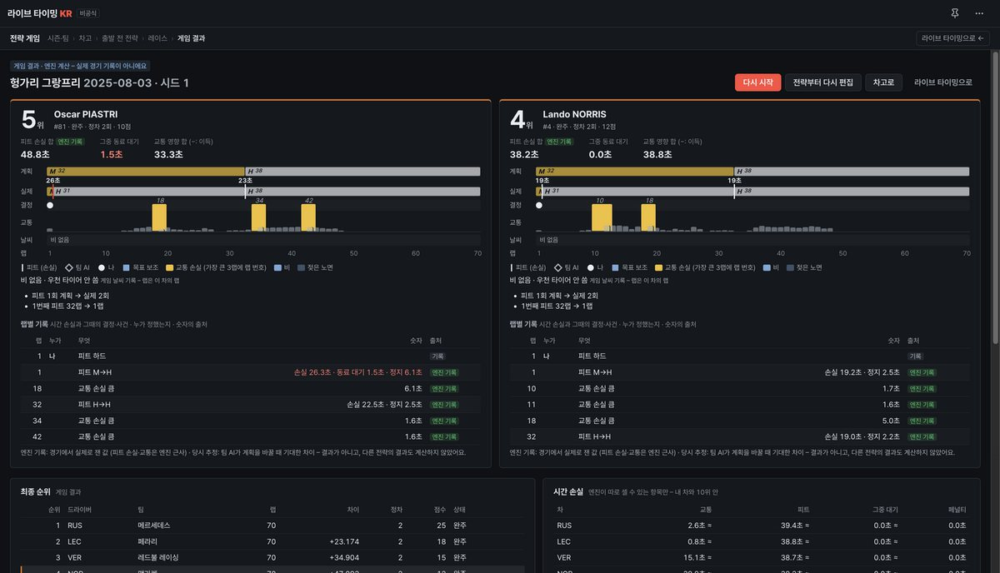

<div align="center">



# 라이브 타이밍 KR

**F1 세션을 한국어로 보는 데스크톱 앱**<br>
다시보기·실시간 타이밍 · 실제 지도 3D 서킷 · 싱글플레이 전략 게임


[주요 기능](#주요-기능) · [화면](#화면) · [시작하기](#시작하기) · [사용법](#사용법) · [전략 게임](#전략-게임) · [변경 기록](CHANGELOG.md)


</div>

> [!NOTE]
> 개인적·비상업적 용도로 만든 **비공식** 프로그램입니다. Formula 1 회사들과 관련이 없습니다.

---

## 주요 기능

| 기능 | 한 줄 설명 |
|---|---|
| **한국어 타이밍** | 순위·간격·섹터·미니 섹터·타이어·피트를 한국어로, 레이스 컨트롤 메시지는 번역과 원문을 함께 |
| **다시보기** | 지난 세션을 1~30배속으로 재생하고 원하는 장면으로 이동 |
| **실시간** | 경기 중 연결, 중계 지연(0~10분)을 맞춰 TV보다 먼저 결과가 보이지 않게 |
| **3D 관전** | 실제 위치에 그린 서킷 위에서 헬기·추적·온보드·1인칭 시점, 편집할 수 있는 관전 HUD(관전·분석·최소 프리셋) |
| **분석** | 텔레메트리, 스틴트 페이스, 타이어 전략, 갭 차트, 피트 복귀 예상, 챔피언십 예상 |
| **전략 게임** | 실제 팀을 골라 두 드라이버의 전략과 피트 스톱을 직접 운영 |

<details>
<summary><b>한국어 순위표 자세히</b></summary>

- 팀 색 막대, 한국어 성(예: 베르스타펜), 공식 약자(VER), 팀 이름으로 표시합니다. 마우스를 올리면 전체 이름과 번호가 보입니다.
- 리더와 차이, 앞 차와 간격(1초 이내 강조), 출발 대비 순위 변화(↑ ↓ –).
- **간격 추세:** 최근 3랩 동안 앞 차와의 간격 변화(초록 ▼ 추격 중 · 빨강 ▲ 멀어짐).
- **기준 바꾸기:** 머리글을 눌러 선두 기준 ↔ 집중 드라이버 기준, 최근 랩 ↔ 개인 최고 랩을 바꿔 봅니다.
- 섹터 기록과 **미니 섹터 막대**(보라 전체 최고 · 초록 개인 최고 · 노랑 보통 · 파랑 피트 레인).
- **트랙 리밋(TL)** 횟수, 3회(흑백기)부터 빨갛게 표시합니다.
- 예선은 Q1/Q2/Q3 기록과 탈락선을, 연습은 최고 기록과의 차이를 보여줍니다.
- 열 구성은 **열** 메뉴에서 바꿀 수 있습니다. **컴팩트 보기(▤)** 는 중계 화면 옆에 둘 좁은 순위표입니다.

</details>

<details>
<summary><b>실제 지도 3D 서킷 자세히</b></summary>

- F1 위치 데이터를 서킷 중심선과 OpenStreetMap 도로에 자동으로 맞춥니다(오차 약 1~3 m).
- **위성 사진**(기본 Sentinel-2, 선택: 내 API 키로 Google 고해상도), **실제 지형 높이**, 층수와 높이를 반영한 **건물**, 관중석, 나무, 호수와 바다를 그립니다.
- 시가지 서킷의 좁은 도로와 벽·펜스, 야간 경기의 투광 조명과 가로등, 세션 시각에 맞춘 해 위치와 그림자, 세션 날씨 기록으로 비와 구름을 재현합니다.
- 실제 출발 그리드, 피트레인과 팀 차고(FIA 도면 기준), 피트 크루의 타이어 교체, 피트월 스탠드, 마샬 깃발, 세이프티카와 메디컬카를 보여줍니다.
- 팀별 차체, 스티어링 휠 화면과 LED, 2026 액티브 에어로, 핸들을 돌리는 팔까지 움직입니다.
- **화질 설정**(선명 / 균형 / 부드러움)으로 성능을 맞춥니다.

</details>

<details>
<summary><b>분석 도구 자세히</b></summary>

- **드라이버 패널:** 행을 클릭해 열고, Shift+클릭으로 다른 드라이버와 비교합니다. 스틴트, 랩타임·순위 그래프, 이론상 최고 랩, 최고 속도, 피트 정차 시간을 보여줍니다.
- **텔레메트리:** 속도·기어·RPM·스로틀·브레이크, 개인 최고 랩이나 비교 드라이버와 겹친 속도 그래프와 시간 차이(Δ).
- **타이어 전략:** 모든 드라이버의 스틴트를 한 랩 축에 그립니다.
- **지금 피트인하면:** 지금 들어가면 몇 위로 복귀하는지, 앞뒤 차와 몇 초 차이인지 계산합니다(SC·VSC 반영).
- **갭 차트**(레이스 트레이스), **챔피언십 예상**, 랩별 **팀 라디오**(다시보기에서는 그 장면으로 이동), **알림**(적색기·SC·페널티·체커기·순위 변화).

</details>

<details>
<summary><b>실시간 모드 자세히</b></summary>

- **중계 지연** 슬라이더(0~10분)와 −5/−1/+1/+5초 버튼으로 TV와 시점을 맞춥니다. 연결하거나 다시 연결해도 지연을 지킵니다.
- **TV와 맞추기:** TV에 보이는 남은 시간을 입력하거나, 선두가 결승선을 지나는 순간 버튼을 누르면 지연을 계산합니다.
- **멈춤 / 이어서:** TV를 멈추면 같이 멈추고, 멈춘 시간만큼 지연이 늘어납니다.
- **위에 고정:** 전체 화면 중계 위에 창을 띄워 둡니다.
- 연결이 끊기거나 잠자기에서 깨어나면 자동으로 다시 연결합니다. 세션이 바뀌면 화면도 따라갑니다.

</details>

## 화면

<table>
  <tr>
    <td width="50%"><br><sub><b>라이브타이밍</b> · 순위표와 2D 트랙맵, 텔레메트리</sub></td>
    <td width="50%"><br><sub><b>3D 관전</b> · 순위 타워·세션 바·드라이버 카드 (편집 가능한 HUD)</sub></td>
  </tr>
  <tr>
    <td><br><sub><b>1인칭</b> · 모나코, HUD가 스티어링휠과 미러를 피해 배치</sub></td>
    <td><br><sub><b>3D 출발 그리드</b> · 모나코, 실제 그리드 위치</sub></td>
  </tr>
  <tr>
    <td><br><sub><b>홈</b> · 시즌 지구본, 개최·데이터 상태</sub></td>
    <td><br><sub><b>전략 게임</b> · 3D 차고 메뉴</sub></td>
  </tr>
  <tr>
    <td><br><sub><b>전략 게임</b> · 두 드라이버 공통 랩 축 전략 편집</sub></td>
    <td><br><sub><b>전략 게임</b> · 레이스 운영 (두 드라이버 패널)</sub></td>
  </tr>
  <tr>
    <td><br><sub><b>전략 게임</b> · 피트 카메라와 크루</sub></td>
    <td><br><sub><b>전략 게임</b> · 결과와 전략 분석</sub></td>
  </tr>
</table>

## 시작하기

### 필요한 것
- macOS(Apple 실리콘 · 인텔) 또는 Windows
- 직접 빌드하려면 [Node.js](https://nodejs.org)(개발에는 24 버전을 씁니다)

### 빌드해서 설치하기

```bash
git clone https://github.com/kiheon2004/f1-live-kr.git
cd f1-live-kr
npm install
npm run dist      # → dist.noindex/mac-arm64/LiveTimingKR.app
```

만든 `LiveTimingKR.app`을 **응용 프로그램** 폴더로 옮기면 됩니다.

> [!TIP]
> 개인용 서명(ad-hoc)이라 처음 열 때 macOS가 막을 수 있습니다. Finder에서 앱을 **우클릭 → 열기**를 누르세요.

### 개발 중 바로 실행하기

```bash
npm start         # 앱 실행
npm test          # 테스트
```

## 사용법

1. 위쪽에서 **다시보기** 또는 **실시간**을 고릅니다.
2. 다시보기는 시즌과 세션을 고르고 **불러오기**를 누릅니다. 처음 여는 세션은 데이터를 받느라 몇 초 걸리고, 이후에는 저장된 데이터로 바로 열립니다.
3. 맵 위의 **2D / 3D** 로 맵을 바꾸고, 3D에서는 **헬기 · 추적 · 온보드 · 1인칭** 시점을 고릅니다. **⤢** 는 맵을 창 전체로 키웁니다.
4. 순위표의 드라이버를 누르면 아래 패널에서 그 드라이버를 자세히 봅니다.

### 단축키

| 키 | 동작 |
|---|---|
| `Space` | 재생 / 정지 (실시간: 멈춤 / 이어서) |
| `←` `→` | 5초 이동 |
| `Shift` + `←` `→` | 1분 이동 |
| `,` `.` | 실시간 중계 지연 ∓1초 |
| `[` `]` | 실시간 중계 지연 ∓5초 |
| `Esc` | 크게 보기에서 돌아오기 |

### F1 TV 로그인

| | 로그인 없이 | F1 TV 로그인 |
|---|:-:|:-:|
| 실시간 순위 · 메시지 · 라디오 | 가능 | 가능 |
| 실시간 트랙맵(차량 위치) · 텔레메트리 | – | 가능 (Access 이상) |
| 받아 둔 세션 다시보기 | 가능 | 가능 |
| 처음 여는 세션 다시보기 | 막힐 수 있음 | 가능 |

- 오른쪽 위 **F1 TV 로그인**을 누르면 F1 공식 로그인 창이 열립니다. 앱은 비밀번호를 보지 않습니다.
- 받은 토큰은 OS 암호화 저장소(safeStorage)로 이 컴퓨터에만 저장됩니다.
- 2026년 10월부터 F1 기록 서버가 로그인 없는 다운로드를 막고 있습니다. 한 번 받아 둔 세션은 캐시로 계속 열립니다.

## 전략 게임

홈 화면의 **전략 게임**에서 시작하는 싱글플레이 모드입니다. 라이브 타이밍과는 분리된 자체 경기 엔진으로 돌아갑니다.

- **팀 선택 → 3D 차고 → 전략 편집 → 경기 → 결과** 순서로 진행합니다.
- 실제 경기의 랩 수와 참가 명단을 쓰고, 같은 시드는 언제나 같은 경기를 만듭니다(결정론적 엔진).
- 트래픽, 피트 스톱, 날씨, 세이프티카와 레이스 컨트롤, 규정, 사고를 계산합니다. 다른 팀은 AI가 운영합니다.
- **목표 중심 운영:** 페이스·에너지를 직접 고르거나 "앞차 압박 / 뒤차 방어 / 타이어 관리 / 에너지 비축" 같은 목표를 주면 엔진이 같은 규칙으로 지시를 만듭니다(보너스 없음). 언제든 "AI에 맡기기"로 되돌릴 수 있습니다.
- **경기 중 전략 편집:** 두 드라이버의 남은 스틴트를 같은 랩 축에서 고치고 "적용"할 때만 반영됩니다. 지금 / 1랩 뒤 / 2랩 뒤 / 계획 유지를 손실 범위·복귀 순위 범위·교통·팀 동료 대기 위험과 함께 비교합니다.
- **타이어 세트 재고:** 드라이버별 세트를 관리합니다(실제 주말 재고 자료가 없어 게임용 가정 배정으로 표시).
- 타이어 표면·코어 온도, 마모와 남은 상태, 배터리·연료 여유를 원인과 함께 보여주고, 계산하지 않은 "몇 초 이득"은 표시하지 않습니다.
- 고배속 중 중요한 순간(내 피트 윈도, 비 예보 변화, SC/VSC, 손상 등)에 알림·감속·일시정지를 고를 수 있습니다.
- 받아 둔 다시보기 세션으로 새 경기를 앱 안에서 준비할 수 있습니다. 저장 슬롯, 자동 저장, 앱을 다시 켠 뒤 이어하기를 지원합니다.
- 화폐, 상자, 시즌 패스 같은 과금 요소는 없습니다.

설계 문서: [`docs/game/DESIGN.md`](docs/game/DESIGN.md)

## 개발

### 명령

| 명령 | 하는 일 |
|---|---|
| `npm start` | 앱 실행 |
| `npm test` | 전체 테스트(번역 규칙, 데이터 해석, 재생·실시간 엔진, 3D 배치, 게임 엔진) |
| `npm run dist` | macOS 앱 빌드 → `dist.noindex/` |
| `npm run share` | 배포용 zip: macOS(Apple 실리콘·인텔), Windows |
| `npm run vendor` | `node_modules/three`에서 three.js를 `src/renderer/vendor`로 복사 |

> 빌드 폴더 이름이 `.noindex`로 끝나서 Spotlight가 빌드한 앱을 검색 결과에 중복으로 띄우지 않습니다.

### 구조

```text
src/
├─ main/          Electron 메인 프로세스
│  ├─ archive.js    F1 기록 보관소: 세션 목록·데이터 받기, 캐시
│  ├─ live.js       실시간 서버(SignalR) 연결, 자동 재연결
│  ├─ auth.js       F1 TV 로그인과 토큰 암호화 저장
│  ├─ geo.js        서킷 좌표, OSM 받기, F1 좌표 ↔ 실제 좌표 맞추기
│  ├─ scene.js      건물·땅·도로·벽·나무를 3D용으로 변환
│  ├─ gamestore.js  게임 시나리오·저장 파일
│  └─ gameprep.js   받아 둔 세션으로 게임 경기 준비(별도 프로세스)
├─ renderer/      화면
│  ├─ app.js        순위표·트랙맵·패널·알림·일정·재생
│  ├─ replay.js     변경분 데이터로 임의 시점의 상태 재구성, 실시간 지연 큐
│  ├─ map3d.js      3D 서킷과 카메라(three.js)
│  ├─ scenery.js    지형·위성 사진·건물·나무·물
│  ├─ garagekit/    차고 장비 생성
│  └─ game/         전략 게임 화면(메뉴·전략 편집·HUD·피트 카메라)
├─ game/
│  ├─ engine/       결정론적 경기 엔진(트래픽·타이어·피트·날씨·규정·AI)
│  └─ tools/        세션 → 게임 시나리오 변환
└─ shared/ko.js   한국어 표기(드라이버·팀·그랑프리), 용어집, 레이스 컨트롤 번역 규칙
```

- 드라이버 한국어 표기는 `src/shared/ko.js`의 `DRIVERS`에서 고칩니다.
- 조사 자료(출처·날짜·확인/추정 구분)는 [`docs/research/`](docs/research/)에 있습니다.

### 데이터 저장 위치 (macOS)

| 경로 | 내용 |
|---|---|
| `~/Library/Application Support/f1-live-kr/cache` | 받아 둔 세션 데이터 |
| `~/Library/Application Support/f1-live-kr/game` | 게임 시나리오와 저장 파일 |

## 데이터 출처

| 출처 | 쓰는 곳 |
|---|---|
| [livetiming.formula1.com](https://livetiming.formula1.com) | 지난 세션 보관소, 실시간 서버 |
| [Jolpica F1 API](https://github.com/jolpica/jolpica-f1) | 시즌 일정, 서킷 좌표 |
| MultiViewer 서킷 API | 코너 번호, 서킷 모양(이전 데이터가 없을 때) |
| [bacinger/f1-circuits](https://github.com/bacinger/f1-circuits) (MIT, © Tomislav Bacinger) | 서킷 중심선·길이·개장 연도 (`src/data`, 라이선스 `src/data/f1-circuits-LICENSE.md`) |
| © [OpenStreetMap](https://www.openstreetmap.org/copyright) 기여자 (ODbL) | 도로·건물·관중석·벽 (Overpass API, 60일 캐시) |
| [Overture Maps](https://overturemaps.org) (ODbL / CDLA) | 건물 외곽과 높이 |
| Sentinel-2 cloudless – EOX IT Services (CC BY-NC-SA 4.0) | 기본 위성 사진 |
| Mapzen / AWS Terrain Tiles | 지형 높이 |
| [Open-Meteo](https://open-meteo.com) (CC BY 4.0) | 구름 양 |
| Google Map Tiles API (선택) | 고해상도 위성 사진. 사용자 본인 API 키, 디스크에 저장하지 않음 |

지도와 위성 사진의 출처는 앱 화면에도 표시합니다.

| 글꼴·아이콘 | 사용 조건 |
|---|---|
| [Pretendard](https://github.com/orioncactus/pretendard) (앱에 포함) | SIL Open Font License 1.1 – `src/renderer/fonts/PRETENDARD-LICENSE.txt` |
| [Lucide](https://lucide.dev) 아이콘 일부 (앱에 포함) | ISC – `src/renderer/ICONS-LICENSE.txt` |

## 고지

- 이 앱은 **개인적·비상업적 용도**의 비공식 프로그램이며 Formula 1 회사들과 관련이 없습니다.
- F1, FORMULA ONE, FORMULA 1, FIA FORMULA ONE WORLD CHAMPIONSHIP, GRAND PRIX 및 관련 표시는 Formula One Licensing B.V.의 상표입니다.
- 데이터를 재배포하거나 광고·유료화하지 않습니다.

<div align="center"><sub>변경 내역은 <a href="CHANGELOG.md">CHANGELOG.md</a>에 있습니다.</sub></div>
